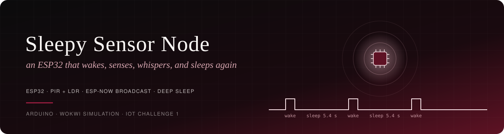
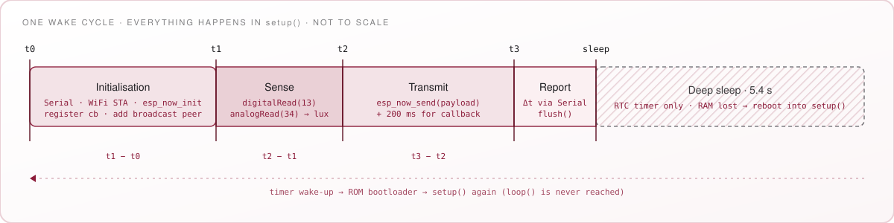
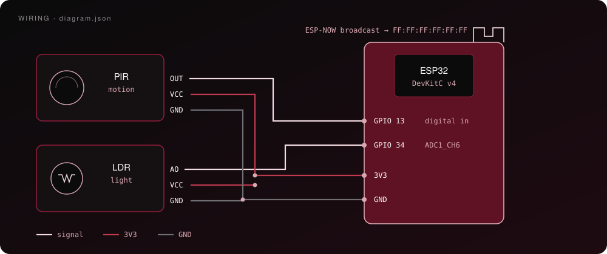
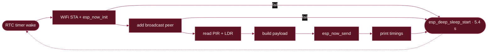

<p align="center">
  
</p>

<p align="center">
  
  
  
  
  <a href="https://wokwi.com/projects/459359124285689857"></a>
</p>

<p align="center"><i>
A battery-minded IoT node: wake on a timer, read motion and light,<br>
broadcast one small packet over ESP-NOW, measure how long each phase took, then go back to sleep.
</i></p>

---

## ✦ Contents

- [What it does](#-what-it-does)
- [Hardware](#-hardware)
- [Firmware anatomy](#-firmware-anatomy)
- [The packet](#-the-packet)
- [Timing instrumentation](#-timing-instrumentation)
- [Energy reasoning](#-energy-reasoning)
- [Run it](#-run-it)
- [Design notes & next steps](#-design-notes--next-steps)

---

## ✦ What it does

Every **5.4 s** the ESP32 wakes from deep sleep and runs one full cycle:

1. brings up Wi-Fi in **station mode** and initialises **ESP-NOW** with a broadcast peer,
2. reads a **PIR** motion sensor (digital) and a **photoresistor** (analog),
3. builds a small text payload and **broadcasts** it to `FF:FF:FF:FF:FF:FF`,
4. prints how many microseconds each phase took,
5. goes back to **deep sleep** until the RTC timer wakes it again.

There is no connection setup, no access point and no handshake. ESP-NOW sends one frame and the node goes back to sleep,
which keeps the radio on for as short a time as possible.

<p align="center">
  
</p>

---

## ✦ Hardware

<p align="center">
  
</p>

| Part | Pin on part | ESP32 pin | Notes |
|:--|:--|:--|:--|
| PIR motion sensor | `OUT` | **GPIO 13** | digital input, HIGH = motion |
| | `VCC` / `GND` | `3V3` / `GND.1` | |
| Photoresistor module | `AO` | **GPIO 34** | analog, **ADC1** channel 6 |
| | `VCC` / `GND` | `3V3` / `GND.1` | |

> [!IMPORTANT]
> **Why GPIO 34?** On the ESP32, **ADC2 cannot be used while Wi-Fi is active** because the radio driver takes it over.
> ESP-NOW runs on the Wi-Fi stack, so the light sensor has to be on an **ADC1** pin. GPIO 34 is ADC1_CH6 and is
> input-only, which suits a sensor.

---

## ✦ Firmware anatomy

Everything lives in [`sketch.ino`](sketch.ino). Deep sleep powers down the CPU and wipes RAM, so a wake-up is
effectively a **reboot**: execution restarts from `setup()`, and `loop()` is never reached. The whole application
is therefore written inside `setup()` as a straight sequence:



Error paths go to sleep as well. If `esp_now_init()` or `esp_now_add_peer()` fails, the node logs the error and
**sleeps until the next cycle** instead of spinning, so a transient fault never drains the battery.

| Function | Role |
|:--|:--|
| `GoToSleep()` | arms `esp_sleep_enable_timer_wakeup(5 400 000 µs)`, flushes Serial, enters deep sleep |
| `OnDataSent()` | ESP-NOW send callback, reports `ok` / `error` (new `wifi_tx_info_t*` signature of Arduino-ESP32 3.x) |
| `setup()` | the whole duty cycle: init → sense → transmit → report → sleep |
| `loop()` | intentionally empty, never executed |

---

## ✦ The packet

The payload is a human-readable, null-terminated string (`msg.length() + 1` bytes), well below ESP-NOW's 250-byte limit:

```text
MOTION_DETECTED-LUX:742
MOTION_NOT_DETECTED-LUX:118
```

The light value is a **linear approximation** from the 12-bit ADC range to 0–1000 lux:

$$
\text{lux} \approx \operatorname{map}(\text{ADC},\;0\ldots4095,\;0\ldots1000) = \frac{1000}{4095}\,\text{ADC}
$$

This is fine for a simulation. A real LDR is strongly non-linear (roughly a power law, R ∝ lux<sup>−γ</sup>), so real
hardware would need a calibration curve.

---

## ✦ Timing instrumentation

Four `micros()` timestamps split the cycle into measurable phases:

| Interval | Phase | What it contains |
|:--|:--|:--|
| `t1 − t0` | **Initialisation** | `Serial.begin` + 200 ms settle, Wi-Fi STA, `esp_now_init`, callback + peer registration |
| `t2 − t1` | **Sensing** | `digitalRead`, `analogRead`, `map`, payload string construction |
| `t3 − t2` | **Transmission** | serial print of the payload, `esp_now_send`, 200 ms wait for the callback |
| — | **Sleep** | configured: 5.4 s (5 400 000 µs) |

Example of the serial output for one cycle:

```text
MOTION_DETECTED-LUX:742
Message queued correctly
Send status: ok
Summary of timing results: [us]
Initialization phase: <t1−t0>
Sensor reading + packet creation: <t2−t1>
Transmission phase: <t3−t2>
Configured deep sleep time : 5400000
Going to deep sleep...
```

> [!NOTE]
> `t0` is taken at the first line of `setup()`, so the **ROM boot after wake-up is not included** in the measurement.
> The real awake time per cycle is somewhat longer than (t3 − t0).

---

## ✦ Energy reasoning

With an active time *t*<sub>on</sub> and sleep time *t*<sub>sleep</sub> = 5.4 s, the average current is

$$
\bar I \;=\; \frac{I_{\text{on}}\,t_{\text{on}} + I_{\text{sleep}}\,t_{\text{sleep}}}{t_{\text{on}} + t_{\text{sleep}}},
\qquad
D = \frac{t_{\text{on}}}{t_{\text{on}} + t_{\text{sleep}}}
$$

The two `delay(200)` calls alone give *t*<sub>on</sub> ≥ 0.4 s, so **D ≳ 7 %**. Because *I*<sub>on</sub> (Wi-Fi radio on, around
10<sup>2</sup> mA) is several orders of magnitude above *I*<sub>sleep</sub> (around 10 µA for the chip in deep sleep, typical datasheet values),
the average is almost entirely set by the active window:

$$
\bar I \approx D \cdot I_{\text{on}}
$$

The lever that matters most is therefore **shortening t<sub>on</sub>**, not lengthening the sleep.

---

## ✦ Run it

**In the browser (no hardware):** open the [Wokwi project](https://wokwi.com/projects/459359124285689857) and press ▶.
The serial monitor shows one block per wake cycle. Click the PIR to trigger motion, and drag the LDR slider to change the light level.

**Locally:**

```text
iot-project-wokwi-esp32/
├── sketch.ino          # firmware
├── diagram.json        # Wokwi circuit (ESP32 + PIR + LDR + wiring)
├── wokwi-project.txt   # link to the online project
└── docs/assets/        # banner + diagrams (SVG)
```

1. Install the **esp32 by Espressif** board package, **v3.x** (needed for the `wifi_tx_info_t` callback signature).
2. Select **ESP32 Dev Module**, open `sketch.ino`, upload, and open the serial monitor at **115200 baud**.
3. To see the packets, flash a second ESP32 with an ESP-NOW receiver that registers `esp_now_register_recv_cb`.

---

## ✦ Design notes & next steps

| Idea | Effect |
|:--|:--|
| Replace the fixed `delay(200)` after sending with a wait on a flag set in `OnDataSent()` | cuts *t*<sub>on</sub> to the actual air time |
| Drop the start-up `delay(200)` when no USB serial is attached | removes ~200 ms of awake time per cycle |
| Keep a cycle counter / last state in `RTC_DATA_ATTR` memory | data survives deep sleep, so the node can send only on change |
| Use the PIR as an `ext0` wake-up source (`esp_sleep_enable_ext0_wakeup(GPIO_NUM_13, 1)`) | event-driven instead of polling, so motion is never missed between wakes |
| Send a packed binary struct instead of a string | smaller frame, shorter radio-on time |
| Fix the Wi-Fi channel explicitly on sender and receiver | ESP-NOW delivery does not depend on the default channel |

---

<p align="center">
  <sub>
    <b>Golsa Shokri</b> · Internet of Things · Challenge 1<br>
    built and simulated on <a href="https://wokwi.com">Wokwi</a>
  </sub>
</p>
